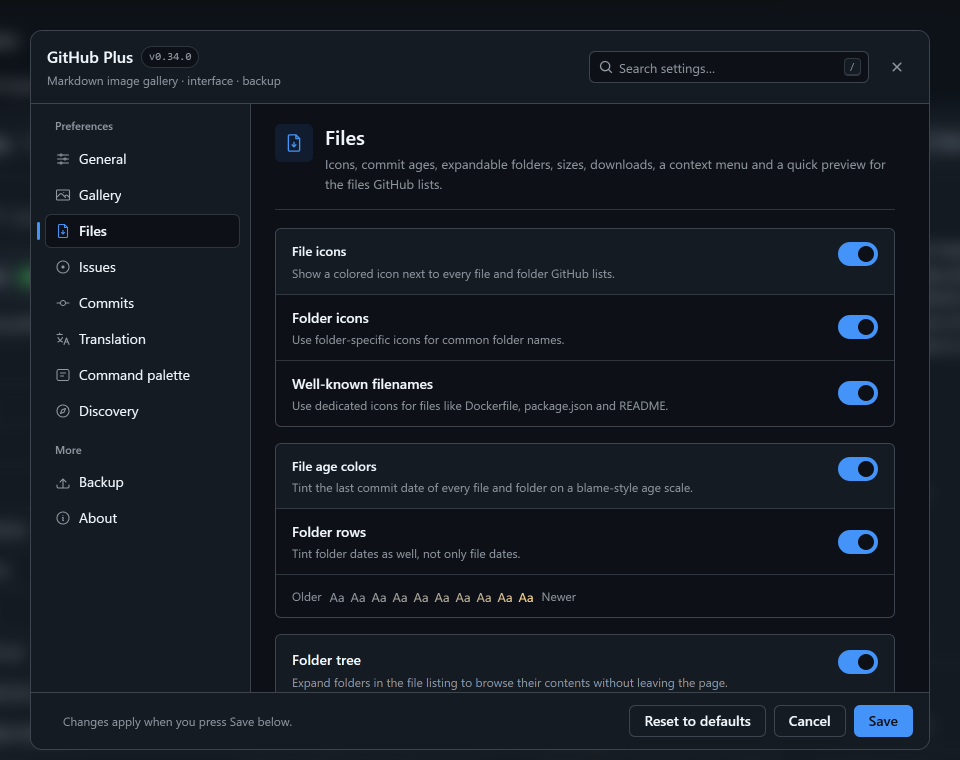
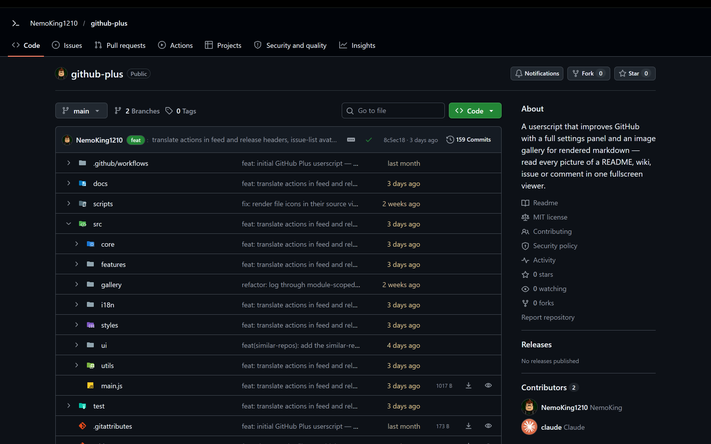
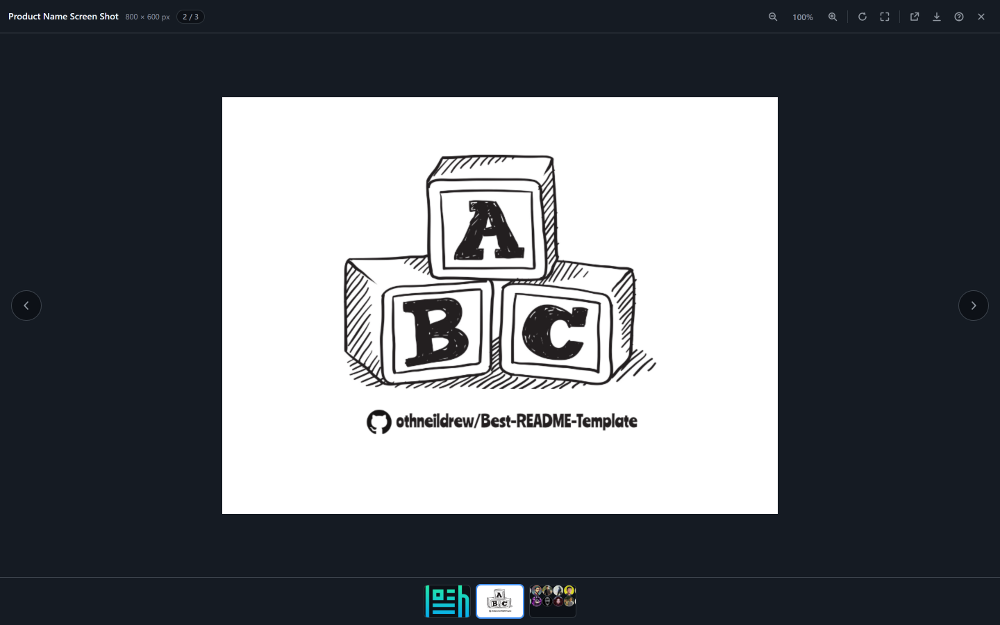
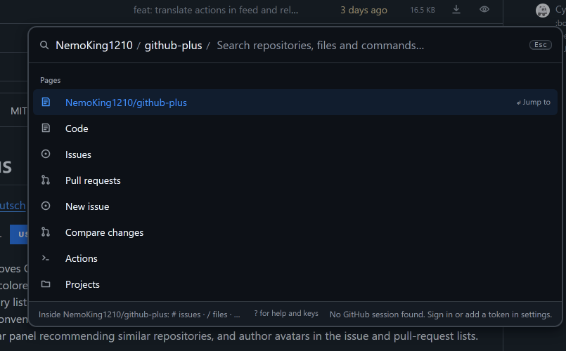
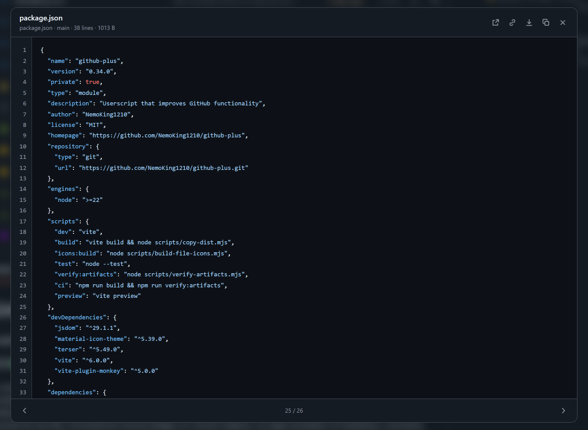
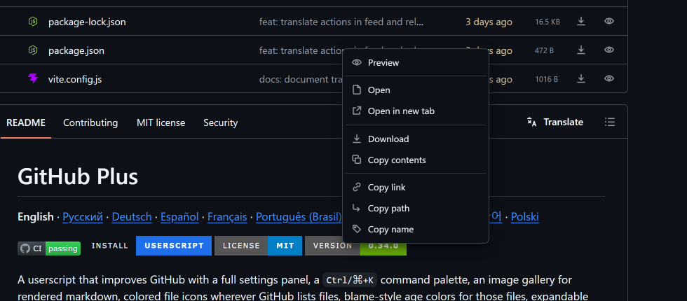
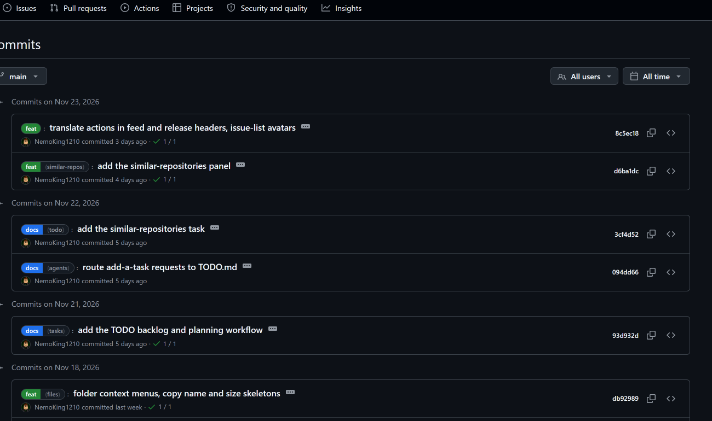
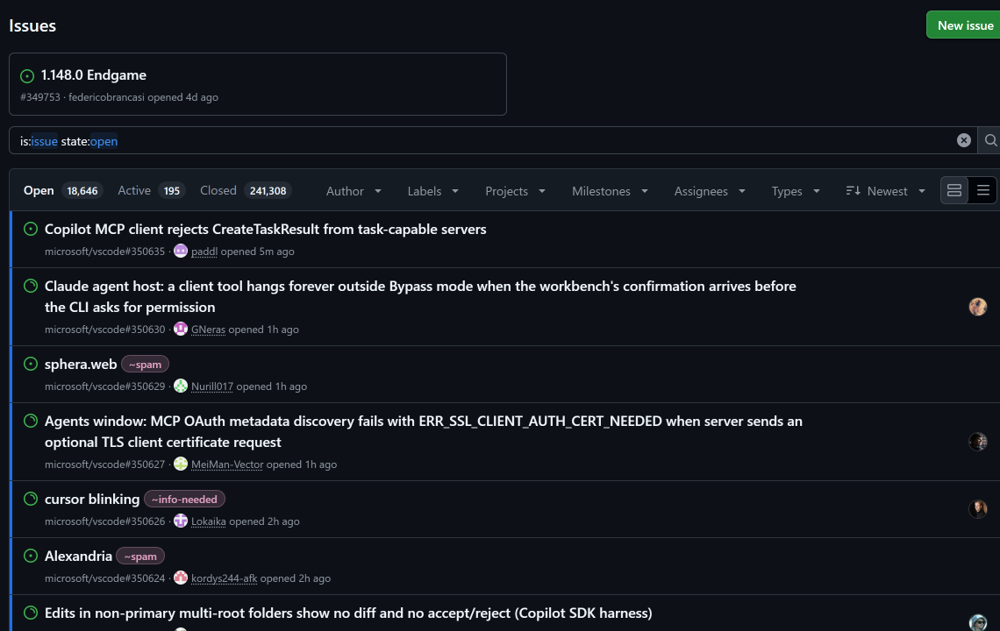
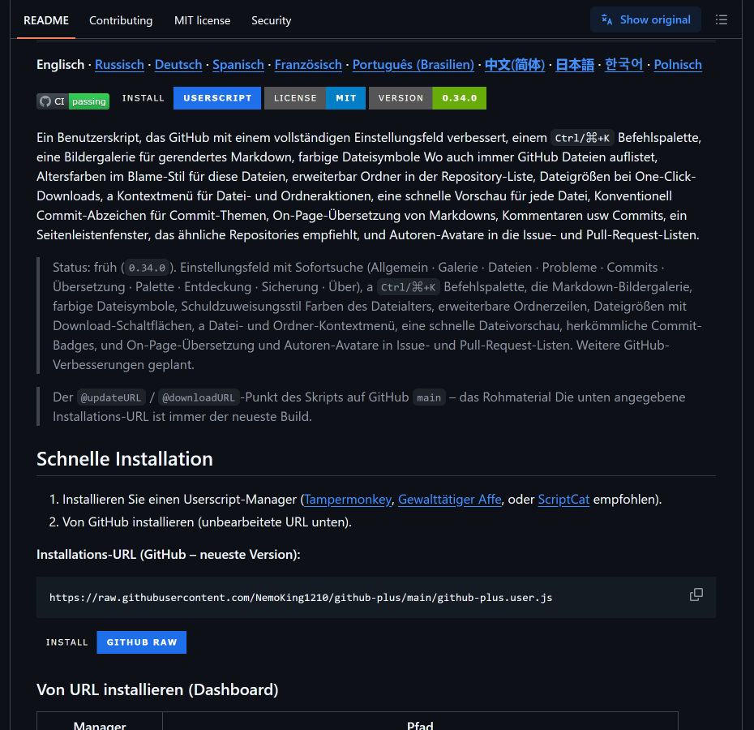
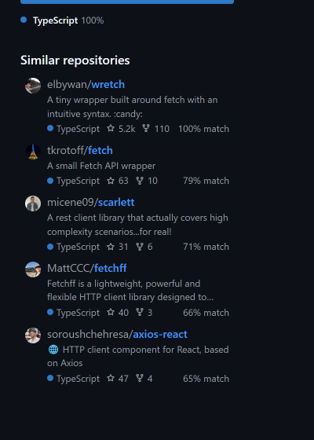

# GitHub Plus

[English](README.md) · [Русский](README.ru.md) · **Deutsch** · [Español](README.es.md) · [Français](README.fr.md) · [Português (Brasil)](README.pt-BR.md) · [中文（简体）](README.zh-CN.md) · [日本語](README.ja.md) · [한국어](README.ko.md) · [Polski](README.pl.md)

[](https://github.com/NemoKing1210/github-plus/actions/workflows/ci.yml)
[](https://raw.githubusercontent.com/NemoKing1210/github-plus/main/github-plus.user.js)
[](https://github.com/NemoKing1210/github-plus/blob/main/LICENSE)
[](https://github.com/NemoKing1210/github-plus/blob/main/CHANGELOG.md)

Ein Userscript, das GitHub verbessert: ein vollständiges Einstellungsfenster,
eine Befehlspalette mit `Ctrl/⌘+K`, eine Bildergalerie für gerendertes Markdown,
farbige Dateisymbole überall dort, wo GitHub Dateien auflistet, Altersfarben im
Blame-Stil für diese Dateien, aufklappbare Ordner in der
Repository-Auflistung, Dateigrößen mit Ein-Klick-Downloads, ein
Kontextmenü für Datei- und Ordneraktionen, eine Schnellvorschau für jede Datei,
Commit-Badges nach Conventional Commits, die Übersetzung von Seiteninhalten und
Avatare der Autorinnen und Autoren in Issue- und Pull-Request-Listen.

> **Status:** früh (`0.34.1`). Einstellungsfenster mit Sofortsuche (Allgemein ·
> Galerie · Dateien · Issues · Commits · Übersetzung · Palette · Entdecken · Sicherung · Info), eine
> Befehlspalette mit `Ctrl/⌘+K`, die Markdown-Bildergalerie, farbige
> Dateisymbole, Altersfarben im Blame-Stil, aufklappbare Ordner,
> Dateigrößen mit
> Download-Schaltflächen, ein Datei- und Ordnerkontextmenü, eine Schnellvorschau
> für Dateien,
> Commit-Badges, die Übersetzung von Seiteninhalten und Autoren-Avatare in Issue- und
> Pull-Request-Listen. Weitere
> GitHub-Verbesserungen sind geplant.

> Die `@updateURL` / `@downloadURL` des Skripts zeigen auf `main` bei GitHub —
> die Installations-URL unten führt immer zur neuesten Version.

## Screenshots

Das echte Userscript auf einer echten GitHub-Seite.



**Einstellungsfenster** — zehn Seiten mit Einstellungen, Entwurfsspeicherung und Sofortsuche über jede Beschriftung.

| | |
|---|---|
| <br>**Dateien** — farbige Symbole, Altersfarben im Blame-Stil, Größen mit Ein-Klick-Downloads, Ordner aufklappen direkt in der Liste und eine Vorschau-Schaltfläche in jeder Zeile | <br>**Bildergalerie** — jedes Markdown-Bild öffnet im Vollbild mit der ganzen Gruppe, Miniaturansichten, Zoom, Verschieben und Drehen |
| <br>**Befehlspalette** — `Ctrl/⌘+K` öffnet eine Palette für das Repository: Seiten, Dateien, Issues, Befehle, Favoriten und Zuletzt verwendet | <br>**Schnellvorschau** — jede Datei öffnet sich, ohne die Seite zu verlassen: gerendertes Markdown, hervorgehobener Quelltext, Bilder, Medien und PDFs |
| <br>**Datei-Kontextmenü** — Rechtsklick auf Datei oder Ordner: öffnen, herunterladen, Inhalt, Link, Pfad oder Namen kopieren sowie Ordner auf- oder zuklappen | <br>**Commit-Abzeichen** — Typen und Bereiche von Conventional Commits werden in der Commit-Liste, auf der Commit-Seite und im Block des letzten Commits zu einem farbigen Token |
| <br>**Autoren-Avatare** — das Avatar der Autorin oder des Autors kehrt in jede Zeile der Issue- und Pull-Request-Listen zurück | <br>**Übersetzung** — README, Kommentare, Commits und Titel direkt übersetzen, während Links, Code und Bilder ihre Auszeichnung behalten |



**Ähnliche Repositorys** — eine Seitenleiste empfiehlt öffentliche Repositorys, die dem geöffneten ähneln, sortiert nach gemeinsamen Themen, Sprache und Sternen.

## Schnellinstallation

1. Installiere einen Userscript-Manager ([Tampermonkey](https://www.tampermonkey.net/),
   [Violentmonkey](https://violentmonkey.github.io/) oder
   [ScriptCat](https://scriptcat.org/) empfohlen).
2. Installiere das Skript von GitHub (Raw-URL unten).

**Installations-URL (GitHub — neueste):**

```
https://raw.githubusercontent.com/NemoKing1210/github-plus/main/github-plus.user.js
```

[](https://raw.githubusercontent.com/NemoKing1210/github-plus/main/github-plus.user.js)

### Installation per URL (Dashboard)

| Manager | Pfad |
|---------|------|
| Tampermonkey | Dashboard → **Utilities** → **Install from URL** |
| Violentmonkey | Dashboard → **+** → **Install from URL** |
| Greasemonkey | Add-on-Menü → **New User Script** → Raw-URL einfügen |
| ScriptCat | Installiere die [Erweiterung](https://scriptcat.org/), dann **Install from URL** mit der GitHub-Raw-URL |

### Manuelle Installation

1. Öffne die gebaute [`github-plus.user.js`](https://github.com/NemoKing1210/github-plus/blob/main/github-plus.user.js) in diesem Repository (oder führe nach dem Klonen `npm run build` aus).
2. Kopiere den gesamten Inhalt der Datei.
3. Erstelle im Userscript-Manager ein neues Skript und füge den Code ein.
4. Speichere und aktiviere das Skript.

## Updates

Das Skript enthält die Metadaten `@updateURL` und `@downloadURL`, die auf die
Raw-Datei bei GitHub zeigen, sodass unterstützte Manager es automatisch
aktualisieren.

Release-Schritte für Maintainer: siehe
[docs/DEVELOPMENT.md § Releasing](docs/DEVELOPMENT.md#releasing).

## Funktionen

### Bildergalerie für Markdown

Jeder gerenderte Markdown-Container auf GitHub ist ein Galerie-Set:

- **Klick auf ein beliebiges Bild** — in einer Repository-README, in der
  Ansicht einer `.md`-Datei, auf einer Wiki-Seite, in einem Issue, Pull Request
  oder Review-Kommentar (überall, wo GitHub `.markdown-body` rendert) oder im
  gerenderten Markdown der Schnellvorschau — öffnet es bildschirmfüllend im
  integrierten Viewer.
- **Das ganze Set durchblättern** — `←`/`→` (oder die Pfeile) wechseln zu den
  anderen Bildern desselben Containers, eine zentrierte Miniaturleiste springt
  an jede Stelle, und der Zähler zeigt die aktuelle Position.
- **Zoomen und Verschieben** — Mausrad, `+`/`−`, Doppelklick und Pinch zoomen
  bis zur eingestellten Obergrenze; Ziehen verschiebt das Bild bei jedem Zoom;
  `0` setzt zurück, `r` dreht; die Nachbarbilder werden vorgeladen, damit das
  Blättern sofort wirkt.
- **Volle Größe auf Wunsch** — verlinkt ein Bild auf eine größere Datei (eine
  Repository-Datei hinter einer `/blob/`-Seite, ein hochgeladener Anhang, eine
  beliebige Bild-URL), wird diese Datei geprüft und eingesetzt. Du bekommst die
  Originalauflösung, ohne ein kaputtes Bild zu riskieren, falls sie nicht
  verfügbar ist.
- **Herunterladen, was du siehst** — beim Überfahren eines Markdown-Bildes
  erscheint eine Download-Schaltfläche, und im Viewer gibt es eine eigene; die
  Datei wird unter ihrem eigenen Namen gespeichert (eine Proxy-Adresse wird zum
  ursprünglichen Dateinamen entpackt), und eine Einstellung blendet beide aus.
- **Standardmäßig unaufdringlich** — Badges, Status-Snippets, Emojis und winzige
  Symbole belegen nie einen Galerieplatz; Bilder behalten den Look von GitHub
  (nur der Cursor deutet an, dass sie die Galerie öffnen), und Klicks mit
  Modifikatoren (Ctrl/Cmd/Shift/Alt) sowie Mittelklicks bleiben bei GitHub —
  eine Datei öffnet sich also weiterhin in einem neuen Tab.
- **Theme-kompatibel** — Galerie und Einstellungsfenster nutzen die
  Farbvariablen von GitHub und folgen damit dem gewählten Theme (hell, dunkel,
  gedimmt).

### Dateisymbole

GitHub zeichnet jede Datei und jeden Ordner mit demselben grauen Symbol, sodass
`.ts` und `.css` gleich aussehen, bis man den Namen liest. GitHub Plus färbt sie
ein:

- **Typ nach Endung** — Sprachen, Konfigurations- und Datenformate, Bilder,
  Medien, Archive und Dokumente bekommen ein eigenes Symbol; zusammengesetzte
  Endungen wie `.d.ts` und `.spec.ts` werden vor der Basisendung geprüft.
- **Bekannte Dateinamen** — `Dockerfile`, `package.json`, `README`,
  `.gitignore`, `tsconfig.json` und Verwandte bekommen ein eigenes Symbol.
- **Ordnerrollen** — `src`, `dist`, `node_modules`, `docs`, `.github`,
  `components`, `utils` und andere gängige Ordner werden ebenfalls markiert.
- **Überall, wo GitHub Dateien auflistet** — Repository-Baum und Unterordner,
  die Dateibaum-Seitenleiste auf Codeseiten, die Dateikopfzeile von Blob-,
  Tree- und Blame-Seiten, Dateiköpfe in Pull Requests und der Diff-Baum,
  Dateilisten von Commits, Codesuche, Gists und Release-Assets.
- **Unaufdringlich** — das native GitHub-Symbol wird ausgeblendet und an Ort und
  Stelle ersetzt; keine Layoutänderungen, keine zusätzlichen Rahmen, und beim
  Deaktivieren sieht GitHub wieder aus wie zuvor.

Die Symbole sind eine kuratierte Teilmenge von
[Material Icon Theme](https://github.com/material-extensions/vscode-material-icon-theme)
(MIT); die Attribution steht in [THIRD_PARTY_LICENSES](THIRD_PARTY_LICENSES).

### Dateialter

GitHub zeigt bereits, wie lange die letzte Änderung jeder Datei zurückliegt,
doch auf einen Blick sehen alle Daten gleich aus. GitHub Plus leiht sich die
Blame-Legende und färbt den Datumstext selbst:

- **Ein Blick, ein Alter** — die neuesten Daten sind warm (`#ffd78d` im dunklen
  Theme, Attention-Gold im hellen), ältere Daten verblassen zu GitHubs
  gedämpftem Grau — eine vier Monate alte Datei wirkt dadurch bereits alt. Die
  Skala ist bewusst auf die jüngste Vergangenheit konzentriert: Tage, Wochen und
  Monate bleiben unterscheidbar, alles über ein Jahr ist schlicht grau. Helle
  und dunkle Themes haben jeweils eine eigene Farbrampe, damit die Farbe in
  beiden kräftig und gut lesbar bleibt.
- **Nichts verschiebt sich** — das Datum behält GitHubs eigenen Text, die
  relative Formulierung und den Tooltip; nur die Farbe ändert sich. Keine Zeile
  wird neu dimensioniert, und die zugängliche Beschriftung bleibt genau die von
  GitHub gerenderte.
- **Dateien und Ordner** — auch Ordnerzeilen werden gefärbt (das Datum meint
  ihre letzte Änderung), und eine Einstellung beschränkt die Funktion auf
  Dateien.
- **Unaufdringlich** — beim Deaktivieren kehrt GitHubs eigene Datumsfarbe zurück
  und es bleibt keine Spur.

### Aufklappbare Ordner

Eine Repository-Auflistung zeigt immer nur eine Ebene, sodass jeder Schritt
entlang eines Pfads eine neue Seite lädt. GitHub Plus macht daraus einen Baum:

- **Ein Klick zum Hineinschauen** — jede Ordnerzeile beginnt mit einem Chevron;
  der Inhalt des Ordners erscheint direkt darunter als gewöhnliche Zeilen, eine
  Ebene pro Stufe eingerückt, und dasselbe Chevron klappt sie wieder zu.
  Verschachtelte Ordner lassen sich genauso beliebig tief öffnen.
- **Der Ordnername navigiert weiterhin** — nur das Chevron klappt auf, ein
  einfacher Klick auf den Namen öffnet den Ordner wie bisher; das Chevron ist
  eine echte Schaltfläche (`aria-expanded`, eine Beschriftung pro Ordner) und
  per Tastatur bedienbar.
- **Alles andere funktioniert weiter** — verschachtelte Zeilen haben GitHubs
  Zeilenform, daher funktionieren Dateisymbole, Altersfarben im Blame-Stil,
  Größen, Download-Schaltflächen, die Schnellvorschau (Vor/Zurück bleibt im
  Ordner) und das Dateikontextmenü ohne weiteres Zutun.
- **Daten und Nachrichten inklusive** — jede verschachtelte Zeile zeigt die
  letzte Commit-Nachricht und die Altersfarbe, gelesen aus derselben Sitzung wie
  die Seite, sodass private Repositories funktionieren und kein API-Token
  verbraucht wird.
- **Ehrliche Grenzen** — ein leerer Ordner sagt das, ein Ordner mit mehr als
  1000 Einträgen zeigt die ersten 1000 mit einem Hinweis, und eine
  fehlgeschlagene Anfrage lässt den Ordner mit einem Toast zusammengeklappt
  statt einen halb gerenderten Baum.
- **Unauffällig** — beim Deaktivieren verschwinden alle Chevrons und
  verschachtelten Zeilen, GitHub bleibt wie es ist; nach einer Navigation sind
  alle Ordner wieder zugeklappt.

### Dateigrößen und Downloads

Die Verzeichnisliste von GitHub zeigt, wann eine Datei zuletzt geändert wurde,
aber nicht ihre Größe; zum Speichern muss man sie erst öffnen. GitHub Plus fügt
beides direkt den Dateizeilen hinzu:

- **Größe auf einen Blick** — jede Datei in einer Repository-Liste bekommt eine
  dezente Größe in einer eigenen Spalte. Größen werden nur für Zeilen nahe dem
  sichtbaren Bereich abgerufen, für die Sitzung zwischengespeichert, und eine
  Datei, deren Größe nicht lesbar ist, zeigt einfach keine.
- **Direkt herunterladen** — jede Dateizeile zeigt ihre Größe am linken Rand
  der Spalte und rechts daneben, am rechten Rand, eine Download-Schaltfläche im
  Stil der GitHub-Icon-Buttons. Die Datei wird unter ihrem eigenen Namen
  gespeichert; die Same-Origin-Raw-Route hält private Repositories
  funktionsfähig, und ein blockierter Abruf öffnet die Datei in einem neuen Tab.
  Die Blob-Ansicht von GitHub zeigt Größe und Download bereits selbst und bleibt
  unverändert.
- **Kein API-Kontingent** — Größen stammen aus einer HEAD-Anfrage an die eigene
  Raw-Adresse der Datei, nicht aus der GitHub-API, sodass das anonyme Limit von
  60 Anfragen pro Stunde unberührt bleibt.
- **Unauffällig** — Ordner behalten eine leere Spalte, und beim Deaktivieren
  entfernt die Funktion jede Größe, jede Schaltfläche und jede Zelle und
  hinterlässt normales GitHub.

### Datei- und Ordnerkontextmenü

Ein Rechtsklick auf eine Datei oder einen Ordner ist der schnellste Weg zur
gewünschten Aktion — und GitHubs eigenes Menü bietet keine davon. GitHub Plus
ersetzt es für Dateien und Ordner:

- **Schnellaktionen** — ein Rechtsklick auf eine Datei in einer
  Repository-Liste, in der Dateibaum-Seitenleiste oder auf einen Dateilink in
  gerendertem Markdown öffnet **Öffnen**,
  **In neuem Tab öffnen**, **Herunterladen**, **Inhalt kopieren**,
  **Link kopieren**, **Pfad kopieren** und **Namen kopieren**. Auf einer Datei-
  oder Blame-Seite erscheint dasselbe Menü (ohne **Öffnen**, denn dort bist du
  schon).
- **Auch Ordner** — ein Ordner in der Liste, im Seitenleisten-Baum oder ein
  Ordnerlink in gerendertem Markdown bekommt sein eigenes kurzes Menü:
  **Öffnen**, **In neuem Tab öffnen**, **Link kopieren**, **Pfad kopieren** und
  **Namen kopieren**. In einem Ordner gibt es nichts herunterzuladen und nichts
  zu lesen, deshalb fehlen diese Aktionen.
- **Aufklappen aus dem Menü** — bei einem Ordner in der Repository-Liste bietet
  das Menü **Aufklappen** oder **Zuklappen**: derselbe Schalter wie am Pfeil der
  Zeile, nur ohne ihn treffen zu müssen.
- **Inhalt kopieren** — der Inhalt einer Textdatei landet direkt in der
  Zwischenablage, ohne die Seite zu öffnen; Binärdateien und alles über 1 MiB
  wird stattdessen mit einem klaren Hinweis abgelehnt, damit weder Müll
  eingefügt wird noch der Tab hängt.
- **Pfad kopieren** — der repository-relative Pfad (`src/main.js`), bereit für
  Terminal, Import oder Link.
- **Namen kopieren** — nur der Name des Eintrags (`src`, `README.md`), für
  Import, Commit-Nachricht oder Suche.
- **Nur wo es hilft** — für Submodule, Bilder, Medien und gewöhnliche Links
  (auch Markdown-Links, die auf keine Datei im Repository zeigen) bleibt das
  native Menü unangetastet; ein Rechtsklick, der weder Datei noch Ordner trifft,
  verhält sich wie zuvor.
- **Auch per Tastatur** — die Kontextmenü-Taste öffnet dasselbe Menü am
  Dateilink, mit vollständiger Pfeilnavigation und wiederhergestelltem Fokus
  nach dem Schließen; beim Deaktivieren kehrt überall das Browser-Menü zurück.

### Schnellvorschau für Dateien

Jede Datei lässt sich öffnen, ohne die Seite zu verlassen — über die
Auge-Schaltfläche in einer Dateiliste, über einen Dateilink in gerendertem
Markdown oder über **Vorschau** im Dateikontextmenü:

- **Gerendert statt roh** — Markdown wird gerendert und bereinigt, Quelldateien
  erhalten Syntaxhervorhebung und Zeilennummern, Bilder, Video und Audio laufen
  an Ort und Stelle, und PDFs öffnen im Betrachter des Browsers, wenn die
  Sicherheitsrichtlinie der Seite den Rahmen erlaubt. Alles andere — auch ein
  PDF, das die Seite blockiert — zeigt eine ehrliche Karte mit **Auf GitHub
  öffnen** und **Herunterladen** statt eines kaputten Rahmens.
- **Durch den Ordner blättern** — Dateien im selben Verzeichnis bilden ein Set:
  Zurück/Weiter-Schaltflächen und die Pfeiltasten wechseln zwischen ihnen, die
  Position steht in der Fußzeile.
- **Vorschau per Halten** — halten Sie die linke Maustaste auf einem Dateinamen
  in einer Liste oder auf einem Dateilink in gerendertem Markdown (auch im
  bereits geöffneten Vorschaufenster) gedrückt, um die Vorschau zu öffnen;
  Haltezeit (standardmäßig 450 ms) und Fortschrittskreis am Zeiger sind
  einstellbar; ein kurzer Klick öffnet weiterhin die Datei, Ziehen oder
  Textauswahl bricht den Griff ab.
- **Aktionen in der Kopfzeile** — die Datei auf GitHub öffnen, ihren rohen
  Inhalt, Link oder Pfad kopieren oder sie unter ihrem eigenen Namen
  herunterladen.
- **Markdown: Vorschau oder Quelle** — ein Segment-Schalter wechselt zwischen
  gerendertem Markdown und seinem Quelltext mit Markdown-Hervorhebung.
- **Sicher mit privaten Repositories** — relative Bilder und Links laufen über
  die Same-Origin-Raw-Route, sodass ein privates README seine Bilder behält;
  Markdown wird bereinigt und externe Bilder laden ohne Referrer.
- **Ehrliche Grenzen** — Text und Markdown bis 2 MiB, PDFs bis 25 MiB, und die
  Hervorhebung ist begrenzt, damit eine riesige Datei den Tab nicht einfriert;
  über dem Limit verweist die Karte auf GitHub und die Rohdatei.

### Commit-Badges

Betreffzeilen nach Conventional Commits zeigen ihr Präfix `type(scope):` als
eine Markierung direkt auf der Seite:

- **Eine zweifarbige Markierung** — der Typ in einem farbigen Segment und der
  Bereich in einem gedämpften, gemeinsam in einer abgerundeten Kontur, gefolgt
  von einem gedämpften Doppelpunkt: `fix(parser): handle empty input` liest sich
  auf einen Blick, ohne ein Zeichen des Betreffs zu ändern.
- **Farbe nach Art, ehrlich zum Rest** — `feat`, `fix`, `docs`, `style`,
  `refactor`, `perf`, `test`, `build`, `ci`, `chore` und `revert` bekommen je
  eine eigene Farbe; andere kleingeschriebene Typen eine neutrale (und lassen
  sich schlicht halten), und ein `!`-Präfix zeigt eine rote Markierung für eine
  Breaking Change.
- **Überall, wo GitHub einen Betreff zeigt** — die Commit-Historie, der
  **Commits**-Tab eines Pull Requests, die Seite eines einzelnen Commits, der
  Block des letzten Commits auf der Repository-Startseite und die klassischen
  Commit-Ansichten. Der Text bleibt unverändert, also verhalten sich Kopieren,
  Suche und Übersetzung wie zuvor, und das Ausschalten der Funktion stellt
  GitHubs eigene Darstellung wieder her.

### Autoren-Avatare

Die Autorinnen und Autoren jeder Zeile in den Issue- und Pull-Request-Listen
bekommen ihr Gesicht zurück:

- **Ein Avatar neben dem Login** — jede Zeile zeigt den 16 px großen runden
  Avatar unmittelbar vor dem Namen in GitHubs eigener Metazeile, sodass eine
  Liste wie ein Kommentarkopf statt wie eine Spalte aus Logins wirkt.
- **Beide Listen, eine Regel** — die Issue- und Pull-Request-Seiten eines
  Repositories und die Dashboards des Kontos nutzen dieselbe Listenansicht von
  GitHub, daher erscheint der Avatar in allen; ein Klick auf den Namen filtert
  die Liste weiterhin wie zuvor.
- **Abschaltbar auf der Seite „Issues“** — ein Schalter stellt GitHubs Markup
  wieder her; ein Bot- oder App-Konto ohne Avatar-Route behält einfach seinen
  Login.

### Übersetzung

Übersetze den Text einer Seite, ohne ihr Markup zu verlieren — eine README,
ein Issue oder eine Diskussion, einen Pull Request, einen Kommentar,
Commit-Nachrichten, einen Titel oder die Markdown-Datei in der Schnellvorschau:

- **Eine Schaltfläche dort, wo der Text steht** — im README-Dateikopf, in der
  Aktionszeile eines Kommentars, bei einem Commit, einem Issue-Titel, im Kopf
  eines Releases oder im
  Kopf einer Feed-Karte. Hat GitHub keinen Kopf, erscheint stattdessen eine
  kleine Leiste über dem Text.
- **Markup bleibt erhalten** — Links, Bilder, Inline-Code, Aufgaben-Checkboxen
  und Hervorhebungen funktionieren weiter: Die Übersetzung ersetzt Textblöcke,
  nie die Struktur darum herum.
- **Auf Klick oder automatisch** — standardmäßig wird nichts gesendet, bis du
  klickst; im automatischen Modus wird ein Block beim Scrollen ins Bild
  übersetzt, und die Schaltfläche **Original anzeigen** bleibt.
- **An Ort und Stelle oder darunter** — ersetze den Quelltext oder zeige die
  Übersetzung darunter; **Original anzeigen** stellt den genauen Text wieder
  her, und die Hover-Anzeige lässt dich hineinschauen, solange der Zeiger oder
  Fokus im Block ist.
- **Auch reine Textdateien** — als Code angezeigte Lizenz- und Hinweisdateien
  (LICENSE, COPYING) bekommen dieselbe Schaltfläche; die Übersetzung erscheint
  unter der Datei, der Code selbst wird nie umgeschrieben.
- **Sechs Anbieter** — kostenloses Google als Standard (ohne Schlüssel,
  inoffiziell und rate-limitiert), oder DeepL, Microsoft, Yandex, ein
  OpenAI-kompatibler Endpunkt oder eine eigene LibreTranslate-Instanz. Der
  übersetzte Text geht an den gewählten Anbieter; API-Schlüssel bleiben in
  diesem Browser, eine Sicherung der Einstellungen enthält sie also.
- **Zwischengespeichert** — eine Übersetzung wird standardmäßig 24 Stunden lang
  wiederverwendet (einstellbar; 0 schaltet den Cache aus) und lässt sich auf der
  Einstellungsseite leeren.

### Befehlspalette

Drücke auf jeder GitHub-Seite `Ctrl/⌘+K` für ein Suchfeld über alles, was du dort
tust:

- **Startet am aktuellen Ort** — auf einer Repository-Seite öffnet sich die
  Palette mit diesem Repository im Pfad, die erste Liste sind also seine Seiten.
- **Mit `Tab` tiefer gehen** — das Feld ist ein Pfad (`owner / repo / Ordner /
  Abfrage`). `Tab` auf einer Repository-Zeile fügt es hinzu, und `Tab` auf einer
  Ordner-Zeile steigt in ihn hinein: die Liste wird zu den Dateien dieses Ordners
  mit Pfaden relativ zum aktuellen Ort, und `Tab` geht so tief weiter, wie es der
  Baum erlaubt. `→` und `←` tun dasselbe bei leerem Feld, du kannst den Pfad
  also ohne Tastenwechsel ablaufen. `Backspace` entfernt die letzte Ebene,
  `Ctrl/⌘+Backspace` leert Pfad und Abfrage, und ein Klick auf ein Pfadsegment
  verwirft alles darunter.
- **Deine Repositories** — alle Repositories, die dir gehören, eigene zuerst, mit
  Sternen, Sprache, letztem Push und Sichtbarkeit an der Zeile. Tippe `@`, um nur
  Repositories zu durchsuchen.
- **Mit Stern markierte Repositories** — die Projekte, zu denen du immer wieder
  zurückkehrst; sie folgen deinen eigenen und tragen einen Stern.
- **Dateien des Repositories im Pfad** — `/` zeigt jeden Pfad darin oder eine
  passende Abfrage; Ordner-Zeilen sind markiert und lassen sich mit `Tab` als
  Ebene öffnen, und eine Datei öffnet sich auf GitHub bei der Revision, die du
  gerade ansiehst.
- **Offene Issues und Pull Requests** — `#` zeigt die offenen Issues und Pull
  Requests des Repositories mit Issue- oder Pull-Request-Kennzeichnung, Autor und
  Aktualisierungszeit; suche nach Titel, Nummer oder Autor. `Tab` auf der Zeile
  Issues oder Pull Requests des Repositories öffnet diese Liste als eigene
  Ebene, ohne `#`.
- **Nachsichtige Suche** — Abfragen ignorieren Groß-/Kleinschreibung und
  lateinische Akzente (`cafe` findet `Café`), bevorzugen Wortanfänge und ganze
  Wörter und werden an Leerzeichen geteilt, wobei jeder Teil passen muss.
- **Seiten als Zeilen** — die eigenen Seiten des Repositories im Pfad (Code,
  Issues, Pull requests, neues Issue, Änderungen vergleichen, Actions, Projects,
  Discussions, Releases, Wiki, Security, Insights und Settings, wenn es dir
  gehört) oder auf oberster Ebene die Seiten deines Kontos (Profil, Repositories,
  Sterne, neues Repository, Benachrichtigungen, Gists, GitHub-Einstellungen,
  Dashboard), jeweils eine Zeile entfernt; eine Repository-Zeile ist mit
  `Springen zu` beschriftet, und eine GitHub-Suchzeile schließt jede Abfrage ab:
  Code im Pfad, Issues für `#`, Repositories für `@` und für eine freie Abfrage
  außerhalb eines Pfades.
- **GitHub-Plus-Aktionen** — öffne das Panel, schalte seine Funktionen um oder
  aktualisiere den Cache; `>` für Befehle.
- **Favoriten und Zuletzt verwendet** — hefte an, was du ständig brauchst
  (`Alt+P`); angeheftete Zeilen tragen einen Stern und stehen zuerst — in der
  leeren Liste wie in Suchergebnissen. Zuletzt geöffnete Zeilen stehen beim
  nächsten Öffnen wieder oben, getrennt pro GitHub-Konto.
- **Aktionen für jede Zeile** — Rechtsklick auf eine Zeile oder `Shift+F10`
  öffnet sie, öffnet sie in einem neuen Tab, kopiert Link, Pfad, Clone-Adresse
  oder Issue-Nummer und heftet sie an oder löst sie.
- **Schnell und unauffällig** — die Palette zeigt die zwischengespeicherte Liste
  sofort, aktualisiert sie im Hintergrund und behält die Auswahl. Ergebnisse
  werden mit ETags für die Sitzung und über Neuladen hinweg gespeichert, die
  Palette verbraucht also kein API-Kontingent; ohne Token liest sie öffentliche
  Daten, und alle Befehle funktionieren trotzdem.
- **Optionales GitHub-Token** — füge es auf der Einstellungsseite der Palette
  hinzu, um private Repositories und vollständige Listen zu sehen (5 000 Anfragen
  pro Stunde statt 60). Das Token wird vor der Nutzung geprüft, nur in diesem
  Browser gespeichert, nie in eine Sicherung geschrieben und nur an
  `api.github.com` gesendet; der Cache gehört zu je einem Konto, ein Kontowechsel
  zeigt also nie fremde Repositories.
- **Tastatur zuerst** — `↑`/`↓` bewegen die Auswahl, `Enter` öffnet,
  `Ctrl/⌘+Enter` öffnet in einem neuen Tab, `Tab` geht in ein Repository, einen
  Ordner oder eine Issue-Liste,
  einen Ordner, `←`/`→` laufen den Pfad ab, `Backspace` verlässt eine Pfadebene, `Alt+P` heftet an,
  `Ctrl/⌘+C` kopiert die Zeile, `?` zeigt alle Tasten und Präfixe, und `Esc`
  schließt (zuerst die Hilfe); in einem Kommentar- oder README-Editor bleibt die
  Palette aus dem Weg und schließt sich bei Navigation selbst. Die
  Tastenkombination ist eine Voreinstellung oder eine beliebige Kombination, die
  du auf der Einstellungsseite der Palette aufzeichnest.

### Ähnliche Repositories

Jede öffentliche Repository-Seite erhält in der Seitenleiste einen Abschnitt
**Ähnliche Repositories** mit Projekten, die dem geöffneten nahestehen:

- **Zwei Datenquellen zur Wahl** — **GitHub** (Standard) sucht über
  `api.github.com` nach Themen und Hauptsprache des Repositorys und ordnet die
  Treffer nach gemeinsamen Themen, gleicher Sprache und vergleichbarer
  Sternenzahl. **SimRepo** zeigt vorbereitete Ähnlichkeitsdaten; es ist ein
  Drittanbieter, daher sendet die Seitenleiste ihm den Namen des geöffneten
  Repositorys, und weitere Seiten erfordern einen Stern für das SimRepo-Projekt —
  die Einstellungskarte sagt das ausdrücklich.
- **Eine Zeile auf einen Blick** — Eigentümer/Name, Beschreibung, Hauptsprache
  mit ihrer Farbe, Sterne, Forks, eine Archiv-Markierung und ein relativer
  Übereinstimmungsprozentsatz; die stärkste Übereinstimmung im Satz liest sich
  als 100 %.
- **Seitenweise** — **Mehr anzeigen** hängt die nächsten Ergebnisse an, wenn die
  Quelle welche hat.
- **Ehrliche Zustände** — Laden, keine Treffer, ein Repository außerhalb des
  Datensatzes, ein erreichtes Abfragelimit mit seiner Rücksetzzeit und ein
  fehlgeschlagener Abruf bekommen jeweils ihre eigene Zeile, sodass die
  Seitenleiste nie einen leeren Kasten zeigt.
- **Nur öffentlich** — die Seitenleiste wird nur für ein Repository abgerufen,
  das GitHub als öffentlich markiert; ein privates, internes oder Repository mit
  unbekannter Sichtbarkeit sendet nie eine Anfrage, und die Seitenleiste
  erscheint dort gar nicht.
- **Ihre Einstellungen** — Hauptschalter, Datenquelle, Ergebnisse pro Seite und
  Cache-Lebensdauer liegen auf der Seite **Entdecken**.

### Einstellungsfenster

Öffne es über die Zeile **GitHub Plus-Einstellungen** im Avatar-Menü (direkt
unter GitHubs eigenem Eintrag **Settings**), über den Einstellungsbefehl der
Palette oder über den Menübefehl des Userscript-Managers.
Änderungen sind Entwürfe: Nichts wird gespeichert, bis du **Speichern** drückst;
**Abbrechen**, der Klick auf den Hintergrund und `Escape` verwerfen den Entwurf;
**Auf Standard zurücksetzen** fragt vorher nach.

## Einstellungen

Gespeichert unter `gp_settings_v1`.

| Schlüssel | Standard | Hinweise |
|-----|---------|------|
| `language` | `'auto'` | Sprache der Benutzeroberfläche des Einstellungsfensters (`'auto'` folgt dem Browser) |
| `gallery.enabled` | `true` | Hauptschalter für die Markdown-Bildergalerie |
| `gallery.sources.markdown` | `true` | Schalter pro Quelle (ein Eintrag pro registrierter Quelle) |
| `gallery.skipBadges` | `true` | Badge-Dienste überspringen (auch Badges hinter GitHubs camo-Proxy und Actions-Status-Badges), Emojis, Bilder ≤ 40 px hoch und Bilder kleiner als 80 px in beiden Achsen |
| `gallery.upgradeFullSize` | `true` | Verlinktes Original in voller Größe prüfen und laden |
| `gallery.download` | `true` | Download-Schaltfläche im Viewer und bei überfahrenen Markdown-Bildern |
| `gallery.thumbnails` | `true` | Miniaturleiste im Viewer |
| `gallery.loop` | `true` | Vom letzten Bild zum ersten springen |
| `gallery.maxZoom` | `8` | Zoom-Obergrenze (2× … 16×) |
| `toasts.enabled` | `true` | Toast-Benachrichtigungen |
| `toasts.position` | `'bottom-right'` | `bottom-right`, `bottom-left`, `top-right`, `top-left` |
| `toasts.duration` | `5000` | Ausblendeverzögerung in ms (`0` lässt den Toast bis zum Schließen stehen) |
| `logging.enabled` | `false` | Konsolendiagnose mit GP-Codes, Modul, Details und Stack; standardmäßig aus |
| `fileIcons.enabled` | `true` | Hauptschalter für Datei- und Ordnersymbole |
| `fileIcons.folders` | `true` | Ordnerspezifische Symbole für gängige Ordnernamen |
| `fileIcons.specialNames` | `true` | Eigene Symbole für bekannte Dateinamen |
| `fileAges.enabled` | `true` | Hauptschalter; Blame-artige Altersfarben für aufgelistete Dateien |
| `fileAges.folders` | `true` | Auch Ordnerzeilen färben |
| `fileMeta.enabled` | `true` | Hauptschalter für Dateigrößen und Download-Schaltflächen |
| `fileMeta.sizes` | `true` | Die Größe jeder Datei in Repository-Listen anzeigen |
| `fileMeta.download` | `true` | Download-Schaltfläche in Repository-Listen |
| `fileMenu.enabled` | `true` | Hauptschalter für das Datei- und Ordnerkontextmenü |
| `filePreview.enabled` | `true` | Hauptschalter für die Schnellvorschau von Dateien |
| `filePreview.rowButton` | `true` | Auge-Schaltfläche in den Zeilen der Dateiliste (das Kontextmenü bietet **Vorschau** immer an) |
| `filePreview.longPress` | `true` | Vorschau öffnen, indem die linke Maustaste auf einem Dateinamen oder einem Markdown-Dateilink gehalten wird |
| `filePreview.longPressMs` | `450` | Haltezeit in ms, bis die Vorschau öffnet (200–2000) |
| `filePreview.longPressRing` | `true` | Fortschrittskreis am Zeiger während des Haltens |
| `folderTree.enabled` | `true` | Hauptschalter für aufklappbare Ordnerzeilen in Repository-Auflistungen |
| `commitBadges.enabled` | `true` | Hauptschalter für Conventional-Commit-Badges |
| `commitBadges.unknownTypes` | `true` | Auch kleingeschriebene Typen außerhalb des konventionellen Satzes gestalten |
| `commitBadges.breaking` | `true` | Rote Markierung für ein `!`-Präfix (Breaking Change) |
| `listAvatars.enabled` | `true` | Schalter für Autoren-Avatare in Issue- und Pull-Request-Listen |
| `translate.enabled` | `true` | Hauptschalter für die Übersetzung auf der Seite |
| `translate.provider` | `'google'` | `google` (kostenlos), `deepl`, `microsoft`, `yandex`, `openai`, `libretranslate` |
| `translate.providerConfig.<id>` | je Anbieter | Zugangsdaten und Endpunkt je Anbieter (API-Schlüssel, Region, Ordner, Modell, URL) |
| `translate.targetLang` | `'auto'` | `'auto'` folgt der Sprache der Einstellungen, sonst jeder angebotene Sprachcode |
| `translate.mode` | `'button'` | `button` übersetzt auf Klick; `auto` übersetzt Blöcke beim Scrollen ins Bild |
| `translate.display` | `'replace'` | `replace` ersetzt den Text; `below` zeigt die Übersetzung unter dem Original |
| `translate.reveal` | `'button'` | Ersetzen-Modus: `button` zeigt **Original anzeigen**; `hover` zeigt den Quelltext beim Hovern oder Fokus |
| `translate.linkLabels` | `true` | Auch Linktexte übersetzen |
| `translate.surfaces.<id>` | `true` | Schalter je Ort: `markdown`, `plaintext`, `commits`, `titles`, `preview` |
| `translate.cacheHours` | `24` | Lebensdauer des Caches in Stunden (0 schaltet ihn aus) |
| `commandPalette.enabled` | `true` | Hauptschalter für die Befehlspalette mit `Ctrl/⌘+K` |
| `commandPalette.shortcut` | `'mod+k'` | `mod+k`, `mod+shift+k`, `mod+space`, `alt+k`, `off` oder eine auf der Einstellungsseite aufgezeichnete Kombination |
| `commandPalette.token` | `''` | Optionales GitHub-Token für private Repositories und höhere Limits (nur an `api.github.com`, nie exportiert) |
| `commandPalette.sources.<id>` | `true` | Quellen-Schalter: `commands`, `repositories`, `starred`, `files`, `issues`, `recent` |
| `commandPalette.sources.issues` | `true` | Offene Issues und Pull Requests des aktuellen Repositories |
| `commandPalette.hideForks` | `false` | Forks von Repositories ausblenden |
| `commandPalette.hideArchived` | `false` | Archivierte Repositories ausblenden |
| `commandPalette.cacheHours` | `6` | Lebensdauer des Repository- und Dateibaum-Caches in Stunden (0 schaltet ihn aus) |
| `commandPalette.maxResults` | `30` | Maximale Zeilenzahl je Ergebnisgruppe (10–100) |
| `similarRepos.enabled` | `true` | Hauptschalter für die Seitenleiste **Ähnliche Repositories** |
| `similarRepos.provider` | `'github'` | Datenquelle: `github` (eigene Suche) oder `simrepo` (Drittanbieter) |
| `similarRepos.results` | `5` | Ergebnisse pro Seite (3–20) |
| `similarRepos.cacheHours` | `24` | Cache-Lebensdauer in Stunden (0 deaktiviert den Cache) |

## Wie die Galerie aufgebaut ist

Die Galerie ist ein kleines Framework plus eine Quelle pro Ort, an dem Bilder
vorkommen; ein neuer Ort berührt die Galerie selbst also nie:

| Datei | Rolle |
|------|------|
| `src/ui/viewer.js` | Die Lightbox: `openViewer({ images, index, loop, thumbnails, download, minZoom, maxZoom, resolveImage, labels, onClose })` sowie `closeViewer()` / `isViewerOpen()`. Eigenständig — von jedem Feature wiederverwendbar. |
| `src/gallery/sources.js` | Quellenregister: `registerSource`, `listSources`. |
| `src/gallery/collect.js` | Sammlung: Normalisierung, Filterung (Badges/Emojis/kleine Symbole), Deduplizierung, Begrenzung. |
| `src/gallery/index.js` | Verdrahtung: ein Klick-Listener in der Capture-Phase, das generierte Cursor-Stylesheet, delegierte Hover-Listener für die Download-Schaltfläche, Einstellungs-Listener. |
| `src/gallery/sources/markdown.js` | Die Markdown-Quelle: Container, Bildsuche, Auflösung der vollen Größe. |

Da die Affordanz CSS aus dem Register ist und die Klickbehandlung ein einziger
delegierter Listener auf dem lebenden DOM, funktioniert die Galerie über
clientseitige Navigation und React-Re-Renders hinweg — ohne Scan-Schleife und
ohne Buchführung pro Bild.

### Eine Quelle hinzufügen

```js
import { registerSource } from '../sources.js';

registerSource({
  id: 'mySurface',            // also the settings switch key (gallery.sources.mySurface)
  labelKey: 'source.mySurface',
  hintKey: 'source.mySurfaceDesc',
  containerSelector: '.my-surface',   // one container = one gallery set
  cursorSelector: '.my-surface img',  // gets cursor: zoom-in while enabled
  collect(container) {
    // return [{ node, src, alt?, title?, href? }]
  },
  resolveFull(item) {
    // return the best full-size URL for item, or '' when unknown
  },
});
```

Danach ergänzt du die Schalter an vier Stellen gemeinsam: das Quellmodul +
seinen Import, `DEFAULT_GALLERY.sources.<id>` in `src/core/constants.js` und die
Schlüssel `source.<id>` / `source.<id>Desc` in **allen zehn** Dateien
`src/i18n/locales/*.js`. Das Einstellungsfenster übernimmt die neue Quelle
automatisch aus dem Register.

## Entwicklung

Erfordert Node.js 22 (siehe `.nvmrc`).

```bash
npm install
npm run dev                # vite-plugin-monkey dev server (dev: prefix)
npm run build              # vite build + copy dist/ → root artifacts
npm run verify:artifacts   # fail if dist/ and root artifacts differ
npm run ci                 # build + verify (CI gate)
npm run icons:build        # regenerate the embedded icon subset
npm test                   # Node test runner (unit tests)
```

Bearbeite nur Dateien unter `src/` — `github-plus.user.js` und
`github-plus.meta.js` sind generiert. Siehe [docs/DEVELOPMENT.md](docs/DEVELOPMENT.md)
für Test und Debugging, [CONTRIBUTING.md](CONTRIBUTING.md) für die Regeln,
[docs/ARCHITECTURE.md](docs/ARCHITECTURE.md) für die Modulkarte und Datenflüsse
und [DESIGN.md](DESIGN.md) vor jeder Änderung an sichtbaren Elementen.

## Lizenz

[MIT](LICENSE).

Die gebündelten Dateisymbole stammen aus Material Icon Theme (MIT); siehe
[THIRD_PARTY_LICENSES](THIRD_PARTY_LICENSES).

Ein unabhängiges Projekt, nicht mit GitHub, Inc. verbunden.
