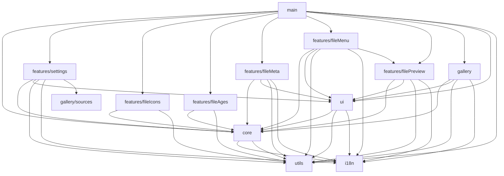
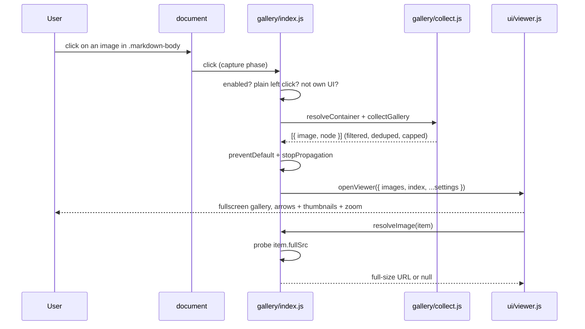
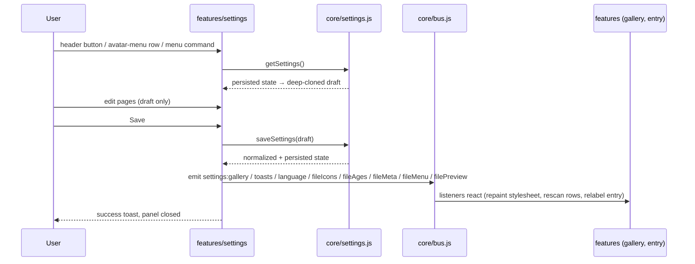

# Architecture

How the pieces fit together and why they are arranged this way. Per-module
detail lives in [`../AGENTS.md`](../AGENTS.md); this document is the map.

## Repository layout

```text
src/
├── main.js                  # Entry: locale init, feature boot, nav overlay reset
├── core/
│   ├── constants.js         # DEFAULT_SETTINGS, storage key, limits
│   ├── settings.js          # load/save + normalization (single source of truth)
│   └── bus.js               # minimal pub/sub (settings:gallery/toasts/language/fileIcons/fileAges/fileMeta/fileMenu/filePreview)
├── i18n/
│   ├── meta.js              # SUPPORTED_LOCALES, aliases, native names
│   ├── index.js             # configureLocale(), t()
│   └── locales/             # one file per locale, registry in locales/index.js
├── gallery/
│   ├── sources.js           # source registry (registerSource / listSources)
│   ├── collect.js           # normalize, filter, de-duplicate, cap
│   ├── index.js             # delegated click + hover, cursor stylesheet, download button
│   └── sources/markdown.js  # the markdown source (side-effect registration)
├── features/settings/
│   ├── index.js             # settings entry: header button, user-menu row, pages
│   ├── userMenu.js          # settings row inside GitHub's user (avatar) menu
│   ├── panel.js             # panel shell: grouped nav, search, pages, draft
│   ├── controls.js          # section / row / field / switch / select / input / button
│   ├── confirm.js           # promise-based confirm dialog
│   └── tabs/                # general.js, gallery.js, files.js, backup.js, about.js
├── features/fileIcons/
│   ├── index.js             # per-surface observers, injection, settings reaction
│   ├── surfaces.js          # where GitHub lists files + row readers
│   ├── match.js             # pickIcon(name, kind) — pure filename matching
│   ├── inject.js            # renderIcon / placeIcon / clearIcons
│   └── iconSet.generated.js # curated Material Icon Theme slice (generated)
├── features/fileAges/
│   ├── index.js             # per-surface observers, date tinting, settings reaction
│   ├── surfaces.js          # file rows that carry a last-commit date
│   ├── age.js               # ageBucket(datetime, now) — pure date → 1…10
│   └── inject.js            # paintAge / clearAges
├── features/fileMeta/
│   ├── index.js             # per-surface observers, lazy size probes, settings reaction
│   ├── surfaces.js          # file rows with a raw address + their column header
│   └── inject.js            # renderMeta / placeMeta / placeHead / clearMeta
├── features/fileMenu/
│   ├── index.js             # delegated contextmenu listener, actions, settings reaction
│   ├── surfaces.js          # where a right-click resolves to a file
│   └── copy.js              # isCopyableContent — pure type/name check
├── features/filePreview/
│   ├── index.js             # listing observers, eye buttons, open/close lifecycle
│   ├── surfaces.js          # listing rows, current ref, sibling set
│   ├── inject.js            # renderPreviewButton / placeCell / placeHead / clearPreviewCells
│   ├── longPress.js         # delegated hold-on-a-file-name gesture
│   ├── kind.js              # previewKind / highlightLanguage / countLines — pure
│   ├── links.js             # resolveMarkdownTarget — pure relative-link rewrite
│   ├── render.js            # loadPreview: HEAD probe + fetch + dispatch
│   ├── markdown.js          # marked + DOMPurify rendering
│   ├── highlight.js         # highlight.js core + registered languages
│   ├── code.js              # gutter + highlighted code block
│   └── cards.js             # binary / empty / too-large / failure cards
├── styles/
│   ├── tokens.css           # :root design tokens (--gp-* palette)
│   └── app.css              # injected stylesheet (gp- prefix)
├── ui/
│   ├── icons.js             # 16×16 stroke glyphs (viewer toolbar, menu actions)
│   ├── toast.js             # notifications (positions, dedup, actions)
│   ├── contextMenu.js       # reusable fixed-position menu
│   ├── filePreview.js       # quick-preview modal shell (header, footer, keys)
│   └── viewer.js            # fullscreen image viewer (reusable lightbox)
└── utils/
    ├── dom.js               # el, append, debounce, eachNode, toArray, escapeHtml, isOwnUi
    ├── download.js          # fetch → blob → <a download>, new-tab fallback
    ├── fileTarget.js        # rawUrlFor / fileTarget / resolveFileTarget — pure
    ├── navigation.js        # watchNavigation (turbo/pjax/history URL watcher)
    ├── scrollLock.js        # counted page scroll lock for modal overlays
    └── size.js              # formatSize — pure size formatting
```

## Module graph



Import direction: `utils ← core ← gallery ← features`. `main.js` may import
from anywhere but owns no feature state; `core/settings.js` knows nothing about
features or the bus; `ui/*` stay reusable primitives that only depend on
`i18n`, `utils` and `core` helpers.

## Feature lifecycle

There is **no scan loop and no document-wide MutationObserver**. Everything
that has to survive GitHub's re-renders is either (a) CSS, (b) a delegated
listener that walks the live DOM at event time, (c) a re-mount triggered by an
explicit navigation event, or (d) one observer on a container GitHub itself
owns — `features/settings/userMenu.js` watches Primer's overlay portal root
(`#__primerPortalRoot__`), which holds nothing but overlays and stays empty
otherwise. `features/fileIcons/`, `features/fileAges/`, `features/fileMeta/`
and `features/filePreview/` follow the same rule at a smaller scale: one observer per known file-list
container (repository tree, PR header list, last-commit cells, and so on),
never one on the document, and a surface whose selector stops
matching turns into a no-op instead of breaking the pagination. File meta adds
two bounded mechanisms of its own: a shared IntersectionObserver that defers a
row's HEAD size probe until it is near the viewport, and a small request queue
that caps concurrent probes.



Why capture phase: GitHub attaches its own delegated click handlers. Resolving
the gallery first and stopping propagation means a gallery image can never both
open the viewer and trigger GitHub's link handling, while modified and middle
clicks stay with the browser.

Why the affordance is generated CSS: the zoom-in cursor is the only thing that
must be applied to page markup — images keep GitHub's own look, with no border
or overlay added — so it lives in one stylesheet built from the registry
(`#gp-gallery-style`). A React re-render cannot strip a stylesheet, and images
rendered long after load are decorated for free. When no source is enabled the
stylesheet is removed entirely, leaving the page stock.

The hover download button follows the same rule: one delegated
`pointerover`/`pointerout` pair resolves the hovered image through the same
`collectGallery`/`matchIndex` path and positions a single
`.gp-download-btn` element appended to `<body>`. Nothing is inserted into
GitHub's markup, there is no per-image state, and the element is dropped on
navigation. Its click is excluded through `isOwnUi()`, so it never opens the
viewer.

The file context menu is the other delegated listener: one capture-phase
`contextmenu` handler resolves the clicked node to a file (a listing row link
or the blob page's own content) at event time, and only then suppresses the
native menu. Folders, media and foreign links fall through to the browser, so
the feature cannot break a right-click it does not own. The menu element itself
lives in `ui/contextMenu.js`, is appended to `<body>`, and is removed on close,
outside press, scroll, resize and navigation.

The quick preview is the one feature that both injects a row button and opens
an overlay. Its observers decorate listing rows with an eye button (the same
per-container pattern as the other file features), and the click opens
`ui/filePreview.js` with a `load` callback supplied by
`features/filePreview/render.js`, so the shell stays a reusable modal and the
feature owns fetching and rendering. A second, delegated capture-phase
`pointerdown` listener implements the optional long press on a file name; it
starts a timer, cancels on movement or release, and swallows the click that
would otherwise navigate. The files of the current directory are the modal's
set; the footer and the arrow keys move through them.

## Settings lifecycle



`saveSettings()` never notifies; the caller emits. That split keeps persistence
in `core` and reactions in the UI/features, and it is what makes a backup import
(`applyExternalSettings`) behave exactly like a footer Save.

## Navigation and overlays

GitHub navigates without a reload (Turbo, plus classic `pushState`), and it
replaces `<body>` while module state lives on. `main.js` subscribes to
`watchNavigation()` and closes the viewer, the panel and the quick preview on
every URL change;
otherwise a "closed" viewer would keep reporting itself open (and swallow
`Escape` for the panel) and a pinned page would stay pinned. The settings entry
subscribes to the same watcher to re-mount its header button; the avatar-menu
row needs no reset, because GitHub unmounts that menu on navigation itself. The
file menu closes through its own `watchNavigation` hook, since its position is
page coordinates that no longer mean anything after the page changes.

## Extension points

| Goal | Touch |
|------|-------|
| A new place with images (diff view, project board, …) | Register a source in `src/gallery/sources/`, import it from `src/gallery/index.js`, add its default switch in `core/constants.js`, add its two locale keys in all ten locales. The settings panel picks it up from the registry. |
| A new settings page | `registerPage({ id, icon, labelKey, descKey, render })` and a module in `features/settings/tabs/`. The page reads and mutates `getDraft()`. |
| A new place GitHub lists files | Add a surface to `src/features/fileIcons/surfaces.js` (`containers`, `rows`, `resolve(row)`); if the rows also show a last-commit date, add it to `src/features/fileAges/surfaces.js`; if they link to a file view and do not already show a size or a download button, add it to `src/features/fileMeta/surfaces.js` (`resolve` returns the raw address; the surface's `header` and `columnLabelKey` place the column's label); if a right-click on a row should open the file menu, add the row to `src/features/fileMenu/surfaces.js`; if the row should offer the eye button, add it to `src/features/filePreview/surfaces.js` (`PREVIEW_SURFACE`). Observers and injection are shared per feature. |
| A new file action | Add an entry to `buildItems()` in `src/features/fileMenu/index.js` (label key, `ACTION_ICONS` glyph, handler), its key in all ten locales, and a toast for the outcome. The menu component itself needs no change. |
| A context menu elsewhere | `openContextMenu({ x, y, label, items })` from `ui/contextMenu.js` — it is a standalone component; give it an anchor and `keyboard: true` for keyboard-triggered opens. |
| A new setting | Add it to `DEFAULT_SETTINGS` + a normalizer in `core/settings.js`, expose a getter, add the control to a tab, and document the key in `README.md` / `AGENTS.md`. Emit the matching bus event on Save if a feature must react. |
| A lightbox somewhere else | `openViewer({ images })` from `ui/viewer.js` — it is a standalone component with localizable, per-call overridable labels. |

## Invariants

- Every injected class is `gp-`-prefixed; no rule targets page markup except the
  gallery affordance stylesheet, which exists only while the gallery is on.
- Nothing is persisted from a panel page render; only the footer Save (or an
  import) writes settings.
- Any value read from storage or a backup goes through normalization — unknown
  values fall back to defaults, never crash the page.
- Injected UI never touches GitHub's own header/markup nodes; it only inserts
  siblings next to them. File icons additionally hide GitHub's glyph with an
  inline style and restore it on teardown, file ages add their `.gp-age-date`
  classes to GitHub's own timestamp, file meta appends its own `td` to a
  row and its own `th` to the table header, and the file menu only replaces a
  native menu; none writes a page-markup CSS rule.
- DOM collections are iterated with `eachNode`/`toArray`, never `for...of`.
