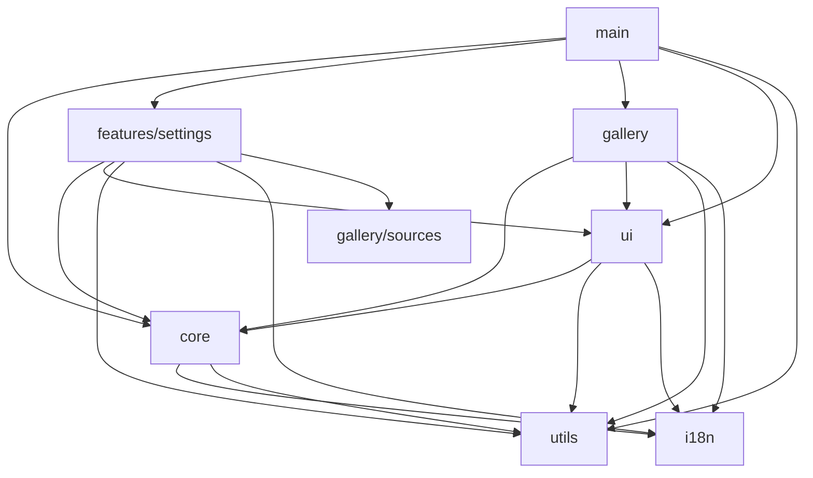
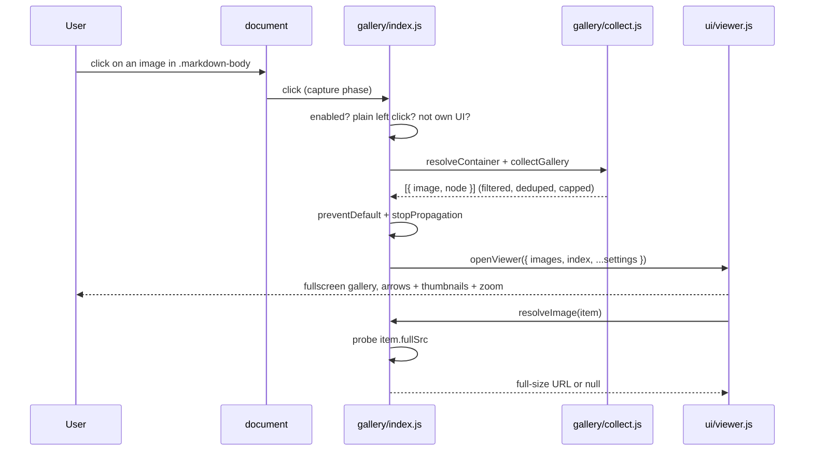
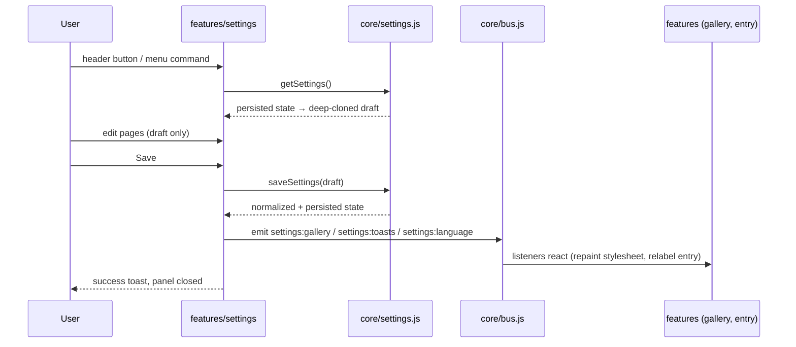

# Architecture

How the pieces fit together and why they are arranged this way. Per-module
detail lives in [`../AGENTS.md`](../AGENTS.md); this document is the map.

## Repository layout

```text
src/
├── main.js                  # Entry: locale init, feature boot, nav overlay reset
├── core/
│   ├── constants.js         # DEFAULT_SETTINGS, storage key, limits
│   ├── settings.js          # load/save + normalization (single source of truth)
│   └── bus.js               # minimal pub/sub (settings:gallery, settings:toasts, settings:language)
├── i18n/
│   ├── meta.js              # SUPPORTED_LOCALES, aliases, native names
│   ├── index.js             # configureLocale(), t()
│   └── locales/             # one file per locale, registry in locales/index.js
├── gallery/
│   ├── sources.js           # source registry (registerSource / listSources)
│   ├── collect.js           # normalize, filter, de-duplicate, cap
│   ├── index.js             # delegated click, cursor stylesheet, bus listener
│   └── sources/markdown.js  # the markdown source (side-effect registration)
├── features/settings/
│   ├── index.js             # settings entry: header button, menu command, pages
│   ├── panel.js             # panel shell: home + pages, draft, Save/Reset/Cancel
│   ├── controls.js          # section / row / field / switch / select / input / button
│   ├── confirm.js           # promise-based confirm dialog
│   └── tabs/                # general.js, gallery.js, backup.js, about.js
├── styles/
│   ├── tokens.css           # :root design tokens (--gp-* palette)
│   └── app.css              # injected stylesheet (gp- prefix)
├── ui/
│   ├── toast.js             # notifications (positions, dedup, actions)
│   └── viewer.js            # fullscreen image viewer (reusable lightbox)
└── utils/
    ├── dom.js               # el, append, debounce, eachNode, toArray, isOwnUi
    ├── navigation.js        # watchNavigation (turbo/pjax/history URL watcher)
    └── scrollLock.js        # counted page scroll lock for modal overlays
```

## Module graph



Import direction: `utils ← core ← gallery ← features`. `main.js` may import
from anywhere but owns no feature state; `core/settings.js` knows nothing about
features or the bus; `ui/*` stay reusable primitives that only depend on
`i18n`, `utils` and `core` helpers.

## Feature lifecycle

There is **no scan loop and no document-wide MutationObserver**. Everything
that has to survive GitHub's re-renders is either (a) CSS, (b) a delegated
listener that walks the live DOM at event time, or (c) a re-mount triggered by
an explicit navigation event.



Why capture phase: GitHub attaches its own delegated click handlers. Resolving
the gallery first and stopping propagation means a gallery image can never both
open the viewer and trigger GitHub's link handling, while modified and middle
clicks stay with the browser.

Why the affordance is generated CSS: the cursor and hover outline are the only
things that must be applied to page markup, so they live in one stylesheet
built from the registry (`#gp-gallery-style`). A React re-render cannot strip a
stylesheet, and images rendered long after load are decorated for free. When no
source is enabled the stylesheet is removed entirely, leaving the page stock.

## Settings lifecycle



`saveSettings()` never notifies; the caller emits. That split keeps persistence
in `core` and reactions in the UI/features, and it is what makes a backup import
(`applyExternalSettings`) behave exactly like a footer Save.

## Navigation and overlays

GitHub navigates without a reload (Turbo, plus classic `pushState`), and it
replaces `<body>` while module state lives on. `main.js` subscribes to
`watchNavigation()` and closes the viewer and the panel on every URL change;
otherwise a "closed" viewer would keep reporting itself open (and swallow
`Escape` for the panel) and a pinned page would stay pinned. The settings entry
subscribes to the same watcher to re-mount its header button.

## Extension points

| Goal | Touch |
|------|-------|
| A new place with images (diff view, project board, …) | Register a source in `src/gallery/sources/`, import it from `src/gallery/index.js`, add its default switch in `core/constants.js`, add its two locale keys in all ten locales. The settings panel picks it up from the registry. |
| A new settings page | `registerPage({ id, icon, labelKey, descKey, render })` and a module in `features/settings/tabs/`. The page reads and mutates `getDraft()`. |
| A new setting | Add it to `DEFAULT_SETTINGS` + a normalizer in `core/settings.js`, expose a getter, add the control to a tab, and document the key in `README.md` / `AGENTS.md`. Emit the matching bus event on Save if a feature must react. |
| A lightbox somewhere else | `openViewer({ images })` from `ui/viewer.js` — it is a standalone component with localizable, per-call overridable labels. |

## Invariants

- Every injected class is `gp-`-prefixed; no rule targets page markup except the
  gallery affordance stylesheet, which exists only while the gallery is on.
- Nothing is persisted from a panel page render; only the footer Save (or an
  import) writes settings.
- Any value read from storage or a backup goes through normalization — unknown
  values fall back to defaults, never crash the page.
- Injected UI never touches GitHub's own header/markup nodes; it only inserts
  siblings next to them.
- DOM collections are iterated with `eachNode`/`toArray`, never `for...of`.
